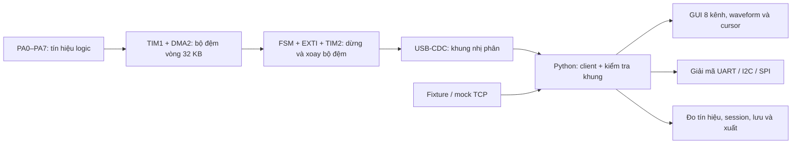

# Báo cáo tổng kết tiến độ STM32 Logic Analyzer sau tích hợp

**Ngày rà soát:** 09/11/2026.

**Repository:** `hijoouzc/logic-analyzer-stm32f401ccu6`.

**Phạm vi:** trạng thái mã nguồn và index trên `sw/integration-stm32`, trước merge commit.

> Báo cáo phân biệt sự hiện diện của mã nguồn với kết quả chạy thực tế. Đã chạy lại bộ kiểm tra không cần thư viện ngoài; chưa chạy được toàn bộ pytest, GUI hoặc STM32 thật. Các tuyên bố hoàn thành trong README, slide và báo cáo lịch sử không được dùng thay cho bằng chứng kiểm thử bản tích hợp.

## I. Tổng quan dự án

### 1. Mục tiêu và kiến trúc

Dự án hướng tới thiết bị phân tích logic số 8 kênh trên STM32F401CCU6 WeAct Black Pill V3.0, lấy mẫu tối đa theo cấu hình 6 MHz, bộ đệm 32.768 mẫu và ứng dụng Python trên máy tính. Mỗi mẫu là một byte chứa trạng thái PA0–PA7; đây là thu thập mức logic, không phải đo điện áp analog.

Luồng chính đã có mã nguồn:



- **Firmware:** C, STM32 HAL/CMSIS; cấu hình clock 84 MHz và USB 48 MHz; TIM1 phát yêu cầu DMA2 Stream5 Channel6 đọc `GPIOA->IDR`; TIM2 đếm phần sau trigger. [Mã điều khiển lõi](../firmware/Core/Src/la_core.c), [cấu hình timer/DMA](../firmware/Core/Src/tim.c).
- **Giao tiếp máy tính:** USB OTG FS ở lớp CDC, được pyserial truy cập như cổng serial. Giao thức có lệnh 5 byte, phản hồi điều khiển 7 byte, dữ liệu 32.776 byte; header dữ liệu `5A A5`, số nguyên Little-Endian và XOR. [Hợp đồng giao thức](../spec/protocol.md).
- **USART1 trên PA9:** phát UART thử nghiệm 115200 bps để nối jumper sang kênh đo; không phải đường truyền dữ liệu 32 KB chính giữa máy tính và STM32.
- **Ứng dụng:** PyQt5, pyqtgraph, NumPy và pyserial; có dữ liệu ngoại tuyến, mock TCP, decoder và công cụ xuất file. [Điểm khởi chạy](../software/main.py), [dependencies](../software/requirements.txt).
- **Phần cứng đầu vào:** có đặc tả bảo vệ/đệm và tài liệu chip/kit. Các thư mục `hardware/sim`, `hardware/design/schematic_pdf`, `hardware/bom` hiện chỉ có `.gitkeep`; chưa có thiết kế hoặc kết quả mô phỏng để nghiệm thu.

### 2. Các nhánh và mục tiêu hợp nhất

| Vai trò | Nhánh | Commit nguồn |
| --- | --- | --- |
| A — nền tích hợp | `sw/complete2_stm32_software` | `777539f2281e49090352adb4129689ec95f78ba6` |
| B — nguồn bổ sung | `sw/complete-stm32-software` | `8b9988512e4ea5b034c8669a80d2dd1fdc9a925a` |
| Kết quả đang review | `sw/integration-stm32` | HEAD tại A; MERGE_HEAD tại B; chưa có merge commit |

Tổ tiên chung là `a67aa395a912ad6cd71b2d1dac9e7303c14419c6`. A có 5 commit riêng, B có 9 commit riêng; khác biệt nội dung hai đầu nhánh là 61 đường dẫn. Quá trình hợp nhất giữ lịch sử hai nhánh bằng merge thông thường, kết hợp GUI/firmware nền A với các luồng giao tiếp, lưu dữ liệu và kiểm thử của B. Chi tiết commit có trong [nhật ký tích hợp](../software/INTEGRATION_REPORT.md).

### 3. Cách đánh giá và đếm chức năng

Mỗi dòng ở mục II là một hạng mục chức năng; không đếm từng hàm hoặc từng test tham số hóa thành một chức năng riêng.

| Ký hiệu | Tiêu chí |
| --- | --- |
| **ĐT** | Đã có luồng triển khai trong mã, chưa phát hiện khoảng trống triển khai cụ thể trong phạm vi mô tả; không đồng nghĩa đã nghiệm thu |
| **MP** | Có triển khai nhưng còn thiếu thành phần hoặc có điểm lệch cần làm rõ/sửa so với yêu cầu |
| **CT** | Chưa tìm thấy triển khai trong repository hiện tại |
| **KCP** | Có kiểm chứng bằng chạy test, chỉ trong phạm vi được ghi rõ; chưa xác nhận toàn bộ chức năng |
| **CKT** | **CHƯA KIỂM THỬ** chức năng thực thi; đọc code/cú pháp không được tính là kiểm thử chức năng |

**Thống kê theo 34 dòng ở mục II:** 27 ĐT, 4 MP, 3 CT. Trong 27 ĐT có 5 hạng mục KCP, 22 hạng mục CKT. Có 7 hạng mục chưa hoàn thiện về triển khai, gồm MP và CT; con số này không bao gồm các hạng mục đã có mã nhưng còn thiếu kiểm thử. **Chưa có bằng chứng nghiệm thu toàn hệ thống từ STM32 tới GUI.** Không quy đổi các số đếm này thành phần trăm hoàn thành.

Nguồn A/B trong bảng chỉ nơi giữ hoặc kết hợp thay đổi; các thành phần chung có thể đã tồn tại trước khi phân nhánh. Phạm vi rà soát gồm toàn bộ 30 tệp Python qua AST, các module nghiệp vụ, mã nối ngoại vi/USB, test firmware, cấu trúc thư mục và liên kết project CubeIDE. Thư viện ST được đối chiếu tại những đường gọi liên quan; báo cáo không xác nhận đã kiểm định toàn bộ thư viện hoặc datasheet.

## II. Các chức năng đã triển khai

| STT | Chức năng | Mô tả | File/Module | Trạng thái |
| --- | --- | --- | --- | --- |
| 01 | Lấy mẫu số 8 kênh | A/chung: PA0–PA7, TIM1, DMA byte circular, mảng tĩnh 32 KB; 9 mức từ 10 kHz tới 6 MHz. Chưa đo tần số thực hoặc dung lượng SRAM toàn chương trình. | [la_core.c](../firmware/Core/Src/la_core.c), [la_core.h](../firmware/Core/Inc/la_core.h), [tim.c](../firmware/Core/Src/tim.c) | **ĐT · CKT** |
| 02 | FSM, pre-trigger và trigger cạnh | A: có IDLE→ARMED→PRE_SAMPLING→WAIT_TRIGGER→POST_SAMPLING→TRANSFERRING; EXTI rising/falling và TIM2 26.214 mẫu. Cơ chế kích ngắt HT chưa được nối rõ ràng với điều kiện của HAL; xem R1. | [la_core.c](../firmware/Core/Src/la_core.c), [stm32f4xx_it.c](../firmware/Core/Src/stm32f4xx_it.c) | **MP · CKT** |
| 03 | Free-run và xoay bộ đệm | A/chung: free-run bỏ qua EXTI; chốt NDTR, xoay từ vị trí ghi và truyền đủ bộ đệm với tham chiếu 6554. Chưa xác nhận thứ tự mẫu trên DMA thật. | [la_core.c](../firmware/Core/Src/la_core.c), [la_protocol.c](../firmware/Core/Src/la_protocol.c) | **ĐT · CKT** |
| 04 | Timeout capture | A: có bảng timeout theo tần số và hook SysTick. Mốc khởi đếm hiện đặt lại sau pre-sampling; cần đồng bộ với ngân sách thời gian trong đặc tả và host, xem R2. | [la_core.c](../firmware/Core/Src/la_core.c), [logic_client.py](../software/gui/logic_client.py) | **MP · CKT** |
| 05 | USB streaming và watchdog | A: khối tối đa 512 byte, kiểm tra `TxState`, các lần chờ có giới hạn 100 ms và có đường thoát lỗi. Chưa thử rút cáp, treo host hoặc thời hạn tổng của một block. | [la_protocol.c](../firmware/Core/Src/la_protocol.c), [usbd_cdc_if.c](../firmware/USB_DEVICE/App/usbd_cdc_if.c) | **ĐT · CKT** |
| 06 | Phát UART loopback và LED | A/chung: PA9 phát `TEST_LA_2026\r\n` định kỳ; PC13 báo capture. VBUS sensing đang tắt trong code USB. Chưa nối PA9→PA0 kiểm tra thực tế. | [la_testgen.c](../firmware/Core/Src/la_testgen.c), [usart.c](../firmware/Core/Src/usart.c), [usbd_conf.c](../firmware/USB_DEVICE/Target/usbd_conf.c) | **ĐT · CKT** |
| 07 | Bộ nhận lệnh phía MCU | A: ring 64 byte, xử lý ở main, Ping/Abort/NAK, drop khi TRANSFERRING. Có lệch quy tắc quét trượt khi tham số sai nhưng checksum đúng, xem R3. | [la_protocol.c](../firmware/Core/Src/la_protocol.c) | **MP · CKT** |
| 08 | Giao thức nhị phân phía PC | B: tạo lệnh, kiểm tra sync/status/count/offset, XOR, parse và serialize capture dùng chung. Kiểm tra fixture bằng stdlib không thay thế chạy module NumPy này. | [protocol.py](../software/protocol.py) | **ĐT · CKT** |
| 09 | Client serial và kiểm soát đồng thời | B + tích hợp: lock, đọc phân mảnh/quét trượt, NAK echo, timeout, Abort qua worker và ACK; đọc header đã đệm trước khi xử lý cờ Abort. Chưa chạy FakeSerial/TCP/COM thật. | [logic_client.py](../software/gui/logic_client.py) | **ĐT · CKT** |
| 10 | Quét cổng và hotplug | A + tích hợp: ưu tiên thiết bị STM32, lọc cổng không dùng, nhập URL/cổng thủ công; Ping tự động chạy qua worker. Nhận diện VID/PID hoặc mô tả vẫn cần thử với driver thật. | [main_window.py](../software/gui/main_window.py): `_get_available_ports`, `_refresh_ports`, `_check_hotplug` | **ĐT · CKT** |
| 11 | GUI và vòng đời tác vụ | A + B: menu, drawer, bảng/terminal, theme chung, khóa các lệnh khi bận, đóng cửa sổ chờ worker. Khởi động mặc định chưa nạp fixture. Chưa chạy Qt sau tích hợp. | [main_window.py](../software/gui/main_window.py), [theme.py](../software/gui/theme.py), [qt_bootstrap.py](../software/qt_bootstrap.py) | **ĐT · CKT** |
| 12 | Vẽ waveform 8 kênh | A + B: trục thời gian chung, mức H/L, vạch trigger/tham chiếu; nén đoạn phẳng để vẽ nhưng giữ dữ liệu gốc. Chưa kiểm tra ảnh hoặc hiệu năng; chưa có bằng chứng 60 FPS. | [waveform_widget.py](../software/gui/waveform_widget.py): `render_data`, `_update_curve_data` | **ĐT · CKT** |
| 13 | Quản lý kênh | A + B: tên có escape HTML, màu riêng từng instance, ẩn/hiện và sắp lại chiều cao, menu ngữ cảnh. Chưa chạy các ca resize/ẩn hết kênh. | [waveform_widget.py](../software/gui/waveform_widget.py), [main_window.py](../software/gui/main_window.py) | **ĐT · CKT** |
| 14 | Decoder UART | A + B: UART 8-N-1, baudrate tùy chọn, lấy mẫu tâm bit, escape byte, metadata tâm bit/data span và hết frame. Đã kiểm tra đầu vào list ở 5 tần số; chưa kiểm tra đường NumPy/GUI/tín hiệu thật. | [uart_decoder.py](../software/decoders/uart_decoder.py) | **ĐT · KCP** |
| 15 | Decoder I2C | A + B: địa chỉ 7 bit, R/W, ACK/NACK, START/repeated-START/STOP; giữ độ rộng chú thích START/STOP của A. Đã chạy vector list repeated-start/read/NACK; chưa kiểm tra bus thật; phạm vi hiện tại là địa chỉ 7 bit. | [i2c_decoder.py](../software/decoders/i2c_decoder.py) | **ĐT · KCP** |
| 16 | Decoder SPI | B/chung: 4 mode CPOL/CPHA, MSB/LSB, hai cực tính CS, MOSI/MISO 8 bit. Đã chạy 16 tổ hợp list và biên CS; chưa kiểm tra NumPy hoặc bus thật. | [spi_decoder.py](../software/decoders/spi_decoder.py) | **ĐT · KCP** |
| 17 | Cấu hình analyzer và chú thích | A + B: chọn kênh UART/I2C/SPI, thông số giao thức, giải mã cả trước trigger, SingleBubble/MultiBubble, bảng và tìm kiếm. Một analyzer được chọn tại một thời điểm; tối đa 256 frame cho một lượt dựng bong bóng. | [main_window.py](../software/gui/main_window.py): `_on_add_analyzer_dialog`, `_decode_uart`, `_decode_i2c`, `_decode_spi`; [waveform_widget.py](../software/gui/waveform_widget.py) | **ĐT · CKT** |
| 18 | Zoom, pan, cursor và điều hướng | A + tích hợp: zoom-fit/zoom tới frame, A/B/Δt/1÷Δt, HUD riêng, click/Ctrl+Click liên kết waveform với bảng. Chưa kiểm tra tương tác chuột/phím hoặc tọa độ sau resize. | [waveform_widget.py](../software/gui/waveform_widget.py), [cursors.py](../software/gui/cursors.py) | **ĐT · CKT** |
| 19 | Đo thông số tín hiệu | A: tần số, chu kỳ, duty, độ rộng xung, số cạnh, chọn kênh hoạt động. Suy ra từ mẫu số; nhãn HIGH/LOW không phải phép đo điện áp. Chưa chạy test NumPy của measurements. | [measurements.py](../software/gui/measurements.py), [main_window.py](../software/gui/main_window.py) | **ĐT · CKT** |
| 20 | Quản lý nhiều session | A + B: thêm/đóng tab theo ID, giữ capture và cấu hình kênh/analyzer, Clear xóa capture khỏi session. Các session trong RAM mất khi đóng app nếu chưa lưu. | [main_window.py](../software/gui/main_window.py): `_on_add_session_tab`, `_on_close_session_tab`, `_on_session_tab_changed` | **ĐT · CKT** |
| 21 | Lưu và nhập capture | B + tích hợp: `.lacapture` có version, raw frame, tần số, analyzer, tên/màu/hiển thị; `.bin` được kiểm tra và yêu cầu chọn tần số. Chưa chạy ca lưu–mở hoặc metadata hỏng sau tích hợp. | [main_window.py](../software/gui/main_window.py): `_save_capture_file`, `_open_capture_file`; [protocol.py](../software/protocol.py) | **ĐT · CKT** |
| 22 | Xuất CSV, VCD, PNG, SVG | A + B: CSV theo mẫu; VCD nén cạnh, timestamp tính từ chỉ số mẫu và giữ mốc cuối; PNG chụp plot, SVG dùng exporter pyqtgraph. Chưa sinh/đọc lại file trong lượt nghiệm thu này. | [exporter.py](../software/utils/exporter.py) | **ĐT · CKT** |
| 23 | Offline Mock | A + B: client đọc fixture và gắn metadata 1 MHz dù GUI chọn rate khác. Byte fixture/decoder đã được kiểm tra riêng; chưa chạy luồng client→worker→GUI ngoại tuyến. | [logic_client.py](../software/gui/logic_client.py), [main_window.py](../software/gui/main_window.py) | **ĐT · CKT** |
| 24 | Thiết bị giả lập TCP | B: server loopback, Ping/Abort/Start/NAK, dữ liệu chia khối. Mô phỏng lưu lượng giao thức, không tái tạo DMA, jitter hoặc toàn bộ timeout của MCU. Chưa chạy end-to-end sau merge. | [mock_device.py](../software/tests/mock_device.py), [mock_serial.py](../software/tests/mock_serial.py) | **ĐT · CKT** |
| 25 | Fixture và định dạng mẫu | A + B: file 32.776 byte; đã xác nhận header, LE `(6554, 32768)`, XOR, idle trước trigger, cạnh xuống tại 6554 và 14 byte UART đúng. Generator NumPy chưa được chạy lại ở lượt báo cáo này. | [sample_data_1mhz.bin](../software/tests/sample_data_1mhz.bin), [generate_test_data.py](../software/tests/generate_test_data.py) | **ĐT · KCP** |
| 26 | Bộ kiểm tra không cần dependencies | Bổ sung khi tích hợp: 7 phương thức unittest kiểm tra AST/import nội bộ, fixture, UART, I2C, SPI. Đã chạy lại thành công; không thay thế GUI/serial/firmware. | [verify_integration_stdlib.py](../software/tests/verify_integration_stdlib.py) | **ĐT · KCP** |
| 27 | Bộ test hồi quy và tích hợp PC | A + B + tích hợp: FakeSerial, frame phân mảnh/lỗi, khóa I/O, lưu file, session, ảnh và tương tác; fixture Qt chặn quét phần cứng thật. Pytest chưa được cài nên chưa collection/chạy. | [test_protocol_regressions.py](../software/tests/test_protocol_regressions.py), [test_workflows_regressions.py](../software/tests/test_workflows_regressions.py), [test_branch_integration.py](../software/tests/test_branch_integration.py), [conftest.py](../software/tests/conftest.py) | **ĐT · CKT** |
| 28 | Kịch bản kiểm thử STM32 thật | A/chung + B: 4 bước HIL firmware và script kiểm tra hệ thống thủ công. Có code không đồng nghĩa có log PASS của kit hiện tại; chưa chạy trong lượt này. | [firmware/tests](../firmware/tests), [test_live_hardware_full.py](../software/tests/test_live_hardware_full.py) | **ĐT · CKT** |
| 29 | Công cụ ảnh và lớp tương thích UI | B + tích hợp: 16 crop, so histogram/SSIM; preview chụp GUI thực; theme cũ re-export và cursor cũ chuyển tiếp. Không còn ba bố cục prototype độc lập; điểm ảnh lịch sử chưa đo lại. | [compare_components.py](../software/ui/compare_components.py), [proto.py](../software/ui/proto.py), [COMPONENT_MATCH_REPORT.md](COMPONENT_MATCH_REPORT.md) | **ĐT · CKT** |
| 30 | Project build và đường nạp DFU | A/chung: project CubeIDE, linker 64 KB RAM/256 KB Flash, driver/middleware và hướng dẫn ROM DFU. Kiểm tra tĩnh 39 linked resource không thiếu; chưa build, chưa có xác nhận ELF/map hoặc DFU. | [.project](../firmware/STM32CubeIDE/.project), [.cproject](../firmware/STM32CubeIDE/.cproject), [linker](../firmware/STM32CubeIDE/STM32F401CCUX_FLASH.ld), [README](../README.md) | **ĐT · CKT** |
| 31 | Debug SWD dùng chung | A/chung: `.ioc` giữ PA13/PA14 Serial Wire. Chưa tìm thấy file `firmware/STM32F401_STLink.launch` mà quy chuẩn dự án yêu cầu duy trì. | [firmware.ioc](../firmware/firmware.ioc), [AGENTS.md](../AGENTS.md) | **MP · CKT** |
| 32 | GPIO debug đo trễ ISR | Đặc tả đề cập toggle PB1 để đo jitter; chưa tìm thấy triển khai hoặc dữ liệu đo trong mã hiện tại. | [Kịch bản đặc tả](../spec/logic_analyzer_specification.md); chưa có module thực hiện | **CT · CKT** |
| 33 | Nguồn xung TIM3 cho demo aliasing | Đặc tả đề cập TIM3/PB0 phát 500 kHz; chưa có cấu hình/logic TIM3 trong firmware. Không đồng nhất generator UART với nguồn xung này. | [Kịch bản đặc tả](../spec/logic_analyzer_specification.md); chưa có module thực hiện | **CT · CKT** |
| 34 | Mạch bảo vệ, schematic, PCB, BOM và LTspice | Có yêu cầu thiết kế và tài liệu tham chiếu; thư mục triển khai chỉ có `.gitkeep`. Chưa có artifact chứng minh thiết kế/mô phỏng. | [hardware](../hardware), [đặc tả hệ thống](../spec/logic_analyzer_specification.md) | **CT · CKT** |

## III. Kết quả tích hợp hai nhánh

### 1. Thành phần được giữ và kết hợp

- **Giữ từ A:** toàn bộ firmware và đặc tả; GUI dark theme/assets, measurements, menu kênh, session ID, bong bóng tương tác, marker UART và lựa chọn không vẽ chấm mẫu phần cứng. So sánh index với A cho `firmware/` và `spec/` không có khác biệt.
- **Đưa từ B:** module giao thức dùng chung, cơ chế sở hữu serial/worker, cấu hình decoder, lưu `.lacapture`, mock TCP, Qt bootstrap, launcher Windows và các test hồi quy. Tài liệu/crops UI được giữ dưới dạng bằng chứng lịch sử.
- **Kết hợp:** main window dùng bố cục/tương tác A và lifecycle/storage B; waveform giữ hình học A và thêm nén/ẩn kênh/resize B; UART giữ metadata A với boundary và kiểm tra đầu vào B; exporter giữ vector hóa A với timestamp/mốc cuối B.
- **Bổ sung khi tích hợp:** test chéo session/analyzer/waveform, bộ kiểm tra stdlib, lớp tương thích UI và tài liệu hướng dẫn. Không thay đổi firmware để viết báo cáo này.

### 2. Mười file conflict đã được xử lý ở lượt tích hợp

Các đường dẫn trong bảng sau tương đối từ `software/`. Lượt tạo báo cáo này không merge lại hoặc giải quyết conflict mới.

| File | Xung đột | Hướng giải quyết đã có trong code hiện tại |
| --- | --- | --- |
| `decoders/uart_decoder.py` | Cùng sửa metadata frame | Giữ data span/tâm bit/vị trí mẫu A, dùng boundary hết frame của B; không giữ khóa dict trùng |
| `gui/logic_client.py` | Hai cơ chế serial/cancel | Kết hợp API tương thích với lock, parser và owner I/O B |
| `gui/main_window.py` | Layout, worker và session khác nhau | Giữ UI/measurements A; ghép worker, lưu file và cấu hình B theo ID session |
| `gui/waveform_widget.py` | Cùng sửa render/timing/layout | Giữ tương tác A; ghép compression, màu/visibility, analyzer tùy chọn và resize |
| `tests/generate_test_data.py` | Hai generator | Một API generator, giữ thời gian bit phân số; bỏ hàm cũ trùng và đoạn pack lỗi |
| `tests/sample_data_1mhz.bin` | Binary không merge theo dòng | Sinh theo generator hợp nhất; kiểm tra byte-level và UART; nhật ký xác nhận trùng fixture B |
| `gui/cursors.py` | A xóa, B sửa | Adapter dùng cursor/HUD đang có trong waveform |
| `ui/theme.py` | A xóa, B sửa | Re-export `gui/theme.py`, tránh hai bảng màu độc lập |
| `ui/proto.py` | A xóa, B phát triển prototype | Giữ lệnh preview cũ nhưng chụp GUI tích hợp, không có cửa sổ giả lập thứ hai |
| `utils/exporter.py` | Hai cách xuất VCD | Vector hóa A, timestamp trực tiếp/mốc cuối và kiểm tra đầu vào B |

Git hiện không còn unmerged entry. Điều này chứng minh đã giải quyết conflict ở mức Git; không thay thế kiểm tra các rủi ro chức năng ở mục V.

### 3. Quyết định ảnh hưởng tính tương thích

1. Trục thời gian dùng mẫu tham chiếu 6554 cho cả triggered/free-run/timeout; hai chế độ sau ghi rõ reference. Những đoạn đọc dữ liệu cũ từng coi free-run bắt đầu tại 0 cần đối chiếu lại.
2. `stop_sample`/`stop_time_s` UART nay mô tả hết frame 10 bit. Vùng 8 data bit dùng `data_start_sample` và `data_end_sample`; tâm bit phân số và vị trí lấy mẫu làm tròn là hai loại metadata khác nhau.
3. `Ctrl+S` lưu `.lacapture`; `Ctrl+Shift+S` xuất ảnh. `.bin` không tự mang metadata tần số.
4. Preview `v1/v2/v3` cùng chụp ứng dụng hiện tại; không tái tạo từng prototype cũ. `CursorManager` tương thích dành cho plot thuộc `WaveformWidget`, không phải plot tùy ý.
5. Nén điểm dùng để vẽ không được phép làm mất mẫu gốc hoặc thay đổi cạnh. Đã có test dự kiến; còn phải kiểm chứng runtime, đặc biệt khi xuất SVG và đổi kích thước.

## IV. Kết quả kiểm thử

### 1. Bằng chứng chạy trong lượt lập báo cáo

Python dùng để chạy là **CPython 3.11.9** tại `C:/Users/Admin/AppData/Local/Programs/Python/Python311/python.exe`. Chạy với `-B` để không tạo bytecode mới. Kết quả thực tế:

```text
Ran 7 tests in 0.715s
OK
```

Lệnh pytest kết thúc trước collection:

```text
No module named pytest
```

Đây là lỗi thiếu môi trường, không phải kết quả FAIL của một bài kiểm thử chức năng đã chạy. Các số PASS trong báo cáo lịch sử của B hoặc lời thoại slide không được cộng vào kết quả mới này.

### 2. Ma trận kiểm thử

| Bài kiểm thử | Nội dung | Kết quả | Ghi chú |
| --- | --- | --- | --- |
| Cú pháp Python và cấu trúc import | AST cho 30 file; đường dẫn `software.*`; tên định nghĩa và khóa dict hằng trùng | **PASS** | Có kết quả chạy trong nhóm stdlib; không import/chạy thực tế Qt, NumPy hoặc serial |
| `test_fixture_wire_format` | 32.776 byte, sync/status, LE, XOR, CH0 idle/cạnh tại 6554 | **PASS** | Kiểm tra file fixture hiện có; không chứng minh MCU đã phát khung này |
| `test_fixture_uart_decode_and_combined_metadata` | Fixture→14 frame/chuỗi đúng, data span/tâm bit/vị trí lấy mẫu | **PASS** | Đầu vào list, không vẽ GUI |
| `test_fractional_uart_rates` | UART 115200 tại 500 kHz, 1/2/3/6 MHz | **PASS** | Tín hiệu tổng hợp; không khẳng định mọi baudrate/sample rate đều giải mã được |
| `test_uart_boundary_and_invalid_input` | Frame cuối buffer, range rỗng/đảo, tần số lỗi/thiếu phân giải | **PASS** | Unit test decoder bằng list |
| `test_i2c_repeated_start_read_nack` | START, địa chỉ, data, repeated-start, read, NACK và STOP | **PASS** | Vector tổng hợp, địa chỉ 7 bit |
| `test_spi_modes_bit_orders_and_chip_select` | 16 mode/order/polarity và CS nhả tại cạnh lấy mẫu | **PASS** | Vector list; chưa chạy đường NumPy |
| Tổng bộ stdlib | 7 phương thức unittest nêu trên | **PASS** | Có các subtest; không quy đổi thành số ca pytest |
| Unit/regression NumPy và parser | `test_decoders_regressions.py`, `test_protocol_regressions.py` | **CHƯA KIỂM THỬ** | Lệnh pytest không khởi chạy được; thiếu cả dependencies của ứng dụng |
| Integration test TCP→client→decoder→GUI | `test_gui_integration.py`, các workflow và test chéo nhánh | **CHƯA KIỂM THỬ** | Chưa chạy mock socket end-to-end sau tích hợp |
| GUI | Qt offscreen, resize, tab, khóa lệnh, đóng cửa sổ, marker, chuột/phím | **CHƯA KIỂM THỬ** | Chưa có ảnh chụp mới để đánh giá layout |
| Measurements và lưu/xuất | `.lacapture`, `.bin` lỗi, CSV/VCD/PNG/SVG, độ chính xác thời gian | **CHƯA KIỂM THỬ** | Có code và test dự kiến, chưa có kết quả chạy |
| Liên kết project CubeIDE | 39 linked resource trong `.project` tồn tại | **PASS** | Chỉ kiểm tra đường dẫn, không phải build/link firmware |
| Build firmware và map | Biên dịch/link, 0 error/0 warning, Flash/SRAM | **CHƯA KIỂM THỬ** | Không tìm thấy toolchain trong PATH; chưa có ELF/map cho lượt này |
| HIL firmware 4 bước | `verify_step1` tới `verify_step4` | **CHƯA KIỂM THỬ** | Cần kit và cổng thực; không tự mở COM hoặc chạy script HIL |
| STM32 và front-end thật | Clock, DMA/HT, trigger/jitter/skew, loopback, USB/rút cáp, bảo vệ đầu vào | **CHƯA KIỂM THỬ** | **Chưa kiểm chứng trên phần cứng thật** |
| Toàn hệ thống | Tín hiệu vật lý→capture→USB→GUI→file xuất | **CHƯA KIỂM THỬ** | Chưa đủ cơ sở nghiệm thu bàn giao |
| An toàn merge | `git ls-files -u`, `git diff --cached --check`, so sánh firmware/spec với A | **PASS** | Không còn conflict/whitespace lỗi; firmware/spec không đổi so với A |

Không có kết quả kiểm thử mới cho đường UART vật lý, tốc độ USB, FPS, sai số trigger hoặc độ bền. Những số liệu thiết kế trong đặc tả là mục tiêu/ước lượng cho tới khi có log đo.

## V. Những phần chưa hoàn thiện

### 1. Phát hiện từ mã nguồn cần xử lý hoặc xác minh

Các phát hiện sau không phải kết quả chạy HIL. Chúng đã được đối chiếu code đang có; không sửa firmware trong nhiệm vụ tài liệu này và không tự thay đổi đặc tả chuẩn.

| Mã | Phát hiện và bằng chứng | Ảnh hưởng/rủi ro cần kiểm tra |
| --- | --- | --- |
| R1 | `la_core_start_capture()` gọi `HAL_DMA_Start_IT()` trực tiếp. [HAL DMA đang đi kèm](../firmware/Drivers/STM32F4xx_HAL_Driver/Src/stm32f4xx_hal_dma.c) chỉ bật `DMA_IT_HT` khi `XferHalfCpltCallback != NULL`; chưa thấy mã nghiệp vụ gán callback hoặc bật HTIE rõ ràng. IRQ riêng kiểm tra HTIF trước khi gọi HAL. | Suy luận từ code: không bảo đảm có IRQ đúng mốc Half-Transfer; HTIF có thể chỉ được xử lý khi IRQ khác, như TC, xuất hiện. Cần xác nhận bit HTIE và thời điểm rời PRE_SAMPLING trước khi nghiệm thu capture. Không kết luận đã quan sát lỗi trên kit. |
| R2 | Bảng timeout chứa `16384/fs + 2 s`, nhưng `g_timeout_counter_ms` được reset khi chuyển từ PRE_SAMPLING sang WAIT_TRIGGER; chỉ WAIT_TRIGGER được SysTick tăng. Host vẫn tính `42598/fs + 3.5 s`. | Mốc thực thi chưa khớp cách tính toàn chu trình trong hợp đồng. Khi pre-sampling bị kéo dài hoặc trigger đến muộn ở rate thấp, có nguy cơ host hết hạn trước khi MCU gửi xong. Cần đo từ lúc nhận START và thử sát biên ở 10 kHz. |
| R3 | Trong `la_protocol_process()`, lệnh checksum đúng bị tăng tail 5 byte trước khi kiểm tra rate/trig. [Giao thức mục 1.2](../spec/protocol.md) yêu cầu chỉ bỏ một byte magic khi checksum hoặc tham số sai. | Sai tham số có thể làm mất điểm tái đồng bộ nằm trong khung đang xét. Cần test lệnh lỗi có byte `A5`, nối ngay lệnh hợp lệ và kiểm tra NAK/khôi phục luồng. |
| R4 | Callback dừng capture và SysTick có vòng `while (DMA2_Stream5->CR & DMA_SxCR_EN)` trong ngữ cảnh ISR; chưa có giới hạn chờ. `la_testgen_process()` chưa xử lý mã trả về `HAL_UART_Transmit()`. | Chưa chứng minh ngân sách thời gian ISR hoặc khả năng thoát khi DMA bất thường; chưa đáp ứng đầy đủ quy tắc kiểm tra kết quả HAL. Cần rà soát với tài liệu ST và đo trên kit. |
| R5 | `wait_cdc_tx_ready()` được gọi trước và sau truyền với timeout riêng; các hàm gửi control/footer bỏ qua giá trị bool cuối cùng. | Cần xác nhận deadline tổng 100 ms/block theo hợp đồng và khả năng chẩn đoán lỗi truyền, thay vì suy ra chỉ từ hằng số 100 trong code. |
| R6 | SWD đã cấu hình trong `.ioc`, nhưng file launch dùng chung chưa có; `hardware/` chưa có artifact triển khai, TIM3 demo và PB1 debug chưa có mã. | Các mục MP/CT chưa thể nghiệm thu; không nên coi toàn bộ roadmap trong README/slide là bằng chứng đã hoàn thành. |

### 2. Môi trường và kiểm chứng còn thiếu

- Python 3.11 có pip; lần kiểm tra này không tìm thấy `pytest`, `PyQt5`, `pyqtgraph`, `numpy`, `serial` và `PIL`. Python MSYS2 cũng thiếu các thư viện đó. `software/.venv/Scripts/python.exe` chưa tồn tại. Không cài dependencies hoặc thay đổi môi trường toàn cục trong nhiệm vụ này.
- Toàn bộ pytest đang phụ thuộc fixture QApplication tự động; chỉ cài pytest là chưa đủ. Trên Windows, phần PTY được thiết kế để bỏ qua; các ca FakeSerial/TCP còn lại vẫn cần chạy.
- Chưa kiểm tra trực tiếp hành vi import/package khi khởi động GUI, driver COM, kích thước/xuất ảnh và việc tương tác trong lúc worker chuyển trạng thái.
- UART hiện là 8-N-1; I2C 7 bit; SPI gom byte 8 bit. Chưa có triển khai được nhận diện cho parity UART, I2C 10 bit hoặc độ dài word SPI tùy ý. Đây là giới hạn phạm vi, không phải các tính năng đã được hứa hoàn thiện trong bảng.
- Mỗi lượt capture là single-shot 32 KB, không phải streaming thu liên tục không giới hạn. Một analyzer được chọn cho lượt hiển thị; chưa có cơ chế nhiều analyzer đồng thời.
- Header data của giao thức v1 không có checksum riêng; XOR chỉ kiểm tra payload. Bộ parse kiểm tra các trường hằng theo hợp đồng nhưng không cung cấp bảo vệ header mạnh hơn thiết kế hiện tại.
- Không có kết quả mới về SRAM toàn chương trình: mảng mẫu 32 KB chiếm 50% SRAM danh định, còn stack, dữ liệu HAL/USB và các biến khác phải được đo bằng map. Chưa có cơ sở xác nhận tổng dùng dưới 64 KB chỉ từ kích thước mảng.

## VI. Kế hoạch phát triển tiếp theo

P0 dành cho đường có thể chặn hoặc làm sai chu trình capture; P1 là điều kiện trước bàn giao; P2 là mở rộng sau khi nền tảng được kiểm chứng. Đây là thứ tự công việc đề xuất, không phải xác nhận mọi rủi ro đã tái hiện.

| Ưu tiên | Công việc | Mục tiêu | Tiêu chí hoàn thành |
| --- | --- | --- | --- |
| P0 | Làm rõ và sửa luồng ngắt Half-Transfer R1 theo phạm vi firmware được duyệt | FSM rời PRE_SAMPLING đúng điều kiện, không phụ thuộc IRQ TC ngoài ý muốn | Chứng minh HTIE/callback đúng; log hoặc đo mốc 16.384 mẫu, free-run và edge trigger qua các rate; không bật EXTI trước HT |
| P0 | Đối chiếu timeout MCU/host R2 | Tránh timeout oan hoặc capture chờ sai ngân sách | Thống nhất mốc START/pre/WAIT/post theo SSoT; test 10 kHz và trigger sát hạn, cả mock và kit; host nhận đủ frame đúng thời gian |
| P1 | Tạo môi trường riêng và chạy toàn bộ pytest | Có bằng chứng cho phần PC đã kết hợp | Dependencies cài trong `.venv`, pytest thu thập/chạy xong, lưu log; phân biệt skip PTY có lý do với lỗi |
| P1 | Kiểm tra parser MCU R3 và vòng chờ/return HAL R4–R5 | Khôi phục luồng đúng hợp đồng và bảo đảm thoát lỗi | Test chuỗi lệnh lỗi/đúng nối nhau, DMA lỗi, USB rút cáp; không chèn control frame vào data; giới hạn thời gian được chứng minh |
| P1 | Build project CubeIDE và đọc map | Kiểm tra khả năng nạp và tài nguyên | Build 0 error/0 warning; ghi Flash/SRAM/stack; tổng SRAM dưới 64 KB; linked resource và USER CODE được giữ |
| P1 | Chạy GUI/serial/file regression và kiểm tra ảnh | Xác nhận A/B thực sự tương thích ở runtime | Session thêm/đóng/clear, cấu hình analyzer, cursor/bubble/table cùng tọa độ, khóa I/O, lưu–mở và các file xuất đều đạt test |
| P1 | Nạp kit và chạy 4 bước HIL | Kiểm chứng chuỗi dữ liệu thực | Có log theo firmware/commit/cổng; kiểm tra PA9→PA0, 3 status, Ping/Abort/NAK, watchdog, rate và sai số trigger |
| P1 | Khôi phục cấu hình debug SWD dùng chung | Đáp ứng quy chuẩn debug | Có `firmware/STM32F401_STLink.launch` hợp lệ, được review; SWD không xung đột USB/kênh đo |
| P1 | Hoàn thiện front-end và mô phỏng yêu cầu | Có cơ sở dùng các probe ngoài kit | Có schematic/PCB/BOM, file LTspice và kết quả đạt tiêu chí đã duyệt; không chỉ có thư mục giữ chỗ |
| P2 | Thêm TIM3/PB0 và PB1 debug theo đặc tả, sau khi được duyệt cấu hình ngoại vi | Demo aliasing và đo jitter/skew | Có mã/cấu hình và dữ liệu thực nghiệm tái lập; số liệu không chỉ là tính toán lý thuyết |
| P2 | Đo hiệu năng và ổn định lâu dài | Định lượng throughput, render và độ bền | Có phương pháp đo, dữ liệu thô, thử nhiều capture/resize/rút cáp; chỉ công bố số liệu có bằng chứng |
| P2 | Mở rộng decoder/analyzer khi nhóm có nhu cầu | Phát triển ngoài 8-N-1, I2C 7 bit, SPI 8 bit hoặc một analyzer | Yêu cầu được chốt, có test vector và UI tương ứng; không gắn nhãn hoàn thiện trước khi kiểm thử |

## VII. Hướng dẫn kiểm chứng

Các lệnh dưới đây chạy trong PowerShell tại thư mục gốc repository, trừ khi ghi khác. Đây là hướng dẫn tái lập; các lệnh cài đặt, chạy GUI, mở COM hoặc nạp firmware **chưa được thực hiện** trong nhiệm vụ tài liệu này.

### 1. Kiểm tra hiện trạng và tạo môi trường riêng

```powershell
git branch --show-current
git status
git ls-files -u

$laPython = 'C:/Users/Admin/AppData/Local/Programs/Python/Python311/python.exe'
& $laPython --version
& $laPython -B software/tests/verify_integration_stdlib.py

# Chỉ thực hiện phần cài đặt khi đã được phép; không cài vào Python toàn cục.
& $laPython -m venv software/.venv
& .\software\.venv\Scripts\python.exe -m pip install -r software/requirements-dev.txt
```

Đường dẫn Python 3.11 trên đã được xác nhận tồn tại ở máy hiện tại. Khi chuyển máy, thay bằng đường dẫn Python tương ứng. `requirements-dev.txt` bao gồm requirements ứng dụng, pytest và Pillow cho công cụ so ảnh. Không sao chép nguyên `.venv` giữa các máy.

### 2. Chạy ứng dụng và giả lập

```powershell
& .\software\.venv\Scripts\python.exe software/app.py
```

Chọn **Offline Mock** hoặc cổng `OFFLINE_MOCK`, rồi Start. Dữ liệu fixture là CH0, 1 MHz, UART 115200 8-N-1; văn bản mong đợi `TEST_LA_2026\r\n`. Không có cờ CLI `--mock` trong ứng dụng hiện tại. Có thể dùng [RUN_APP.cmd](../software/RUN_APP.cmd) sau khi tạo đúng `.venv`.

Để kiểm tra giao thức qua TCP, mở terminal thứ nhất:

```powershell
& .\software\.venv\Scripts\python.exe software/tests/mock_serial.py --port 8765
```

Terminal thứ hai chạy ứng dụng như trên; bỏ chọn Offline Mock, nhập `socket://127.0.0.1:8765` vào ô cổng rồi Ping/Start. Mock chỉ bind loopback; kết quả không chứng minh thời gian thực của STM32.

### 3. Chạy test PC và chụp giao diện

```powershell
& .\software\.venv\Scripts\python.exe -B software/tests/verify_integration_stdlib.py
& .\software\.venv\Scripts\python.exe -m pytest software/tests -q
& .\software\.venv\Scripts\python.exe -m pytest software/tests/test_branch_integration.py -q
& .\software\.venv\Scripts\python.exe -m software.ui.proto v3 "$env:TEMP/la-integration-preview.png"
```

Pytest đã có cấu hình offscreen và chặn quét thiết bị thật trong [conftest.py](../software/tests/conftest.py). Script HIL hệ thống chỉ có hàm chạy thủ công và yêu cầu `--port` ở CLI, không được coi là đã chạy khi pytest đạt.

Công cụ so ảnh có sẵn CLI, ví dụ so lại cặp crop lịch sử đang tồn tại:

```powershell
& .\software\.venv\Scripts\python.exe software/ui/compare_components.py docs/ui_reference/crops/ref_comp8_waveform_viewport.png docs/ui_reference/crops/gen_comp8_waveform_viewport.png
```

Lệnh này chỉ đánh giá cặp ảnh truyền vào. Muốn đánh giá UI tích hợp phải chụp và crop lại ảnh tương ứng; không gán điểm của crop cũ cho ảnh mới. Generator fixture có thể chạy bằng `python software/tests/generate_test_data.py` sau khi có NumPy, nhưng sẽ ghi lại file fixture đang được Git theo dõi; không cần chạy chỉ để xem GUI.

### 4. Build và nạp firmware

Repository có project quản lý bởi STM32CubeIDE tại [firmware/STM32CubeIDE](../firmware/STM32CubeIDE), với `.project`/`.cproject`, nhưng **không có Makefile/CMake hoặc script build độc lập được theo dõi trong Git**. Vì vậy không đưa lệnh `make` hay CMake tại thư mục gốc như thể được hỗ trợ sẵn.

1. Mở STM32CubeIDE, dùng **File → Open Projects from File System**, chọn `firmware/STM32CubeIDE` và project `firmware`.
2. Chọn cấu hình **Debug**, dùng **Project → Build Project** hoặc `Ctrl+B` theo README.
3. Lưu console build và map; kiểm tra SRAM/Flash. `.cproject` chỉ ra thư mục build `Debug` của project; ELF dự kiến là `firmware/STM32CubeIDE/Debug/firmware.elf`.
4. Khi có kit, đúng driver và STM32CubeProgrammer, đưa kit vào ROM DFU theo README. Chỉ dùng file ELF thực tế vừa build:

```powershell
Test-Path .\firmware\STM32CubeIDE\Debug\firmware.elf
STM32_Programmer_CLI -c port=usb1 -d firmware/STM32CubeIDE/Debug/firmware.elf -v -s
```

Nếu cần Generate Code bằng CubeMX, phải kiểm tra lại VBUS sensing tắt, NVIC và các khối USER CODE theo [AGENTS.md](../AGENTS.md). Không dùng thao tác sinh code để âm thầm thay đổi kiến trúc.

### 5. Kiểm thử STM32 thực tế

Chỉ chạy khi người vận hành đã chọn đúng cổng và nối phần cứng theo [hướng dẫn HIL](../firmware/tests/README.md). `COM3` dưới đây chỉ là ví dụ, phải thay bằng cổng thực. Loopback cần PA9→PA0; không nhấn KEY khi đo PA0.

```powershell
& .\software\.venv\Scripts\python.exe firmware/tests/verify_step1_freerun.py COM3
& .\software\.venv\Scripts\python.exe firmware/tests/verify_step2_loopback.py COM3
& .\software\.venv\Scripts\python.exe firmware/tests/verify_step3_trigger.py COM3
& .\software\.venv\Scripts\python.exe firmware/tests/verify_step4_edge_cases.py COM3
& .\software\.venv\Scripts\python.exe software/tests/test_live_hardware_full.py --port COM3 --output-dir "$env:TEMP/la-hil-results"
```

### 6. Review Git mà không kết thúc merge

```powershell
git status
git diff --cached --stat
git diff --cached --check
git diff --cached
Get-Content -Encoding UTF8 docs/INTEGRATION_COMPLETION_REPORT.md
```

Báo cáo đang là file mới chưa staged, vì nhiệm vụ này không thay đổi index; `git diff --cached` chỉ hiển thị phần đã staged ở lượt tích hợp. Dùng `Get-Content` hoặc mở trực tiếp file mới để review báo cáo. Không chạy merge/abort/reset/commit/push trong quá trình tạo tài liệu. Upstream hiện vẫn là nhánh A được kế thừa; nếu sau này được phép push phải chỉ rõ nhánh đích tích hợp.

## VIII. Kết luận

Repository đã có nền mã firmware, giao tiếp, GUI, waveform, ba decoder, đo tín hiệu, lưu/xuất, mock và các bộ test trong một trạng thái hợp nhất chờ review. Những thay đổi A/B đã được kết hợp ở các luồng quan trọng và không còn conflict Git.

Đã có bằng chứng chạy cho fixture và decoder với đầu vào list trong bộ stdlib 7 nhóm; 30 file Python đạt kiểm tra AST/đường dẫn nội bộ. Phần parser NumPy, serial, GUI, session, exporter và toàn bộ pytest mới được xác nhận có triển khai/test dự kiến, chưa có kết quả chạy đủ để coi là hoạt động sau merge. Firmware còn các điểm cần làm rõ về HT, timeout, quét trượt và kỷ luật ISR; phần cứng bảo vệ cùng một số công cụ debug/demo chưa triển khai đầy đủ.

Theo tiêu chí 34 hạng mục: **27 đã triển khai, 4 triển khai một phần, 3 chưa triển khai; 5 hạng mục có kiểm chứng trong phạm vi hẹp**. Dự án phù hợp để review kỹ thuật và chuẩn bị kiểm chứng tiếp, **chưa đủ bằng chứng bàn giao một hệ thống đã nghiệm thu**. Chưa build/map, chưa chạy HIL và **chưa kiểm chứng trên phần cứng thật**.

Lượt lập báo cáo chỉ tạo `docs/INTEGRATION_COMPLETION_REPORT.md`; các thay đổi staged từ lượt tích hợp được giữ nguyên. `main`, A, B, HEAD/index và trạng thái merge không bị thay đổi; chưa commit, push hoặc tạo PR. Cần xử lý các mục ưu tiên và bổ sung log/ảnh/số liệu gắn với đúng firmware và bản phần mềm trước khi cập nhật trạng thái nghiệm thu.
