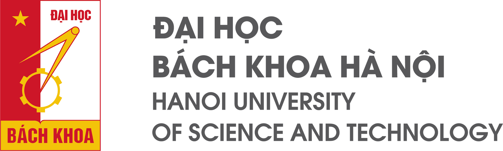

<!-- 
SLIDE 1: BÌA ĐỀ TÀI (HUST TITLE SLIDE)
Thời lượng: 30s
-->
<!-- _header: "" -->
<!-- _footer: "" -->

  
  

  <h1 style="font-size: 2.1rem; line-height: 1.25; color: #c41230; text-transform: uppercase; margin-bottom: 12px;">
    BÁO CÁO TIẾN ĐỘ ĐỀ TÀI 1 
    THIẾT KẾ & XÂY DỰNG LOGIC ANALYZER 8 KÊNH
  </h1>
  

    <b>Học phần:</b> Hệ thống nhúng & Thiết kế giao tiếp nhúng (2026.1) 
    <b>Nền tảng phần cứng:</b> STM32F401CCU6 Development Board (84 MHz) 
    <b>Nhóm sinh viên thực hiện:</b> Nhóm Đề tài 1 · <b>Ngày báo cáo:</b> 11/11/2026
  

<!-- note
Kính thưa thầy và các bạn, hôm nay đại diện cho nhóm, em xin báo cáo tiến độ Đề tài 1: Thiết kế và xây dựng thiết bị Logic Analyzer 8 kênh trên nền tảng vi điều khiển STM32F401CCU6.
Sau đây, em xin phép bắt đầu phần trình bày về mục tiêu và tiến độ triển khai thực tế của nhóm.
-->

---

<!-- 
SLIDE 2: TỔNG QUAN ĐỀ TÀI & CHỈ TIÊU THIẾT KẾ
Thời lượng: 35s
-->

# 01 · TỔNG QUAN ĐỀ TÀI & CHỈ TIÊU THIẾT KẾ
## Đối chiếu yêu cầu tối thiểu của đề tài với cấu hình triển khai của nhóm

<!-- 3 Khối số liệu lớn nổi bật (Big Metric Callouts - Kỹ thuật 5) -->

  

    
8 KÊNH LOGIC

    
PA0 – PA7 (GPIOA IDR)

  

  

    
6 MHz LẤY MẪU

    
Cấu hình danh định (ARR=13)

  

  

    
32 KiB BỘ ĐỆM

    
32.768 mẫu RAM tĩnh (50%)

  

  <h3>Thông tin & Phân công Kỹ thuật</h3>
  
• <b>Đề tài:</b> Topic 1 – Thiết bị Logic Analyzer 
  • <b>Vi điều khiển:</b> STM32F401CCU6 (84 MHz SYSCLK) 
  • <b>Thời gian:</b> Báo cáo tiến độ ngày 11/11/2026 
  • <b>Phần cứng (HW):</b> Mạch bảo vệ đầu vào R-C-Diode 
  • <b>Firmware (FW):</b> Khối thu thập DMA vòng 32 KiB 
  • <b>Phần mềm (SW):</b> Ứng dụng Desktop PyQt5 hiển thị

  <h3>Đối chiếu Chỉ tiêu Thiết kế (Design Targets)</h3>
  <table>
    <tr>
      <th>Chỉ tiêu</th>
      <th>Yêu cầu đề bài</th>
      <th>Thiết kế hiện tại</th>
    </tr>
    <tr>
      <td><b>Số kênh</b></td>
      <td>≥ 2 kênh</td>
      <td>8 kênh logic (PA0 – PA7)</td>
    </tr>
    <tr>
      <td><b>Tần số lấy mẫu</b></td>
      <td>≥ 1 kHz</td>
      <td>
        Cấu hình: 6 MHz (ARR=13) 
        Giới hạn thực tế: Đang xác minh
      </td>
    </tr>
    <tr>
      <td><b>Bộ đệm thu thập</b></td>
      <td>Không bắt buộc</td>
      <td>32.768 mẫu (32 KiB tĩnh)</td>
    </tr>
    <tr>
      <td><b>Bảo vệ đầu vào</b></td>
      <td>12V DC / 200V xung 1ms</td>
      <td>R-C-Diode (Sơ đồ mạch đã có; đang đo kiểm)</td>
    </tr>
  </table>
  

    * <i>Ghi chú: 6 MHz là tần số định thời danh định (ARR = 13); giới hạn tốc độ lấy mẫu thực tế đang trong quá trình đo kiểm nghiệm thu.</i>
  

<!-- note
Kính thưa thầy và các bạn, đại diện cho nhóm, em xin báo cáo tiến độ Đề tài 1: Thiết kế và xây dựng thiết bị Logic Analyzer 8 kênh trên nền tảng vi điều khiển STM32F401CCU6.
So với yêu cầu tối thiểu của đề bài là 2 kênh và tần số lấy mẫu 1 kHz, thiết kế của nhóm hướng tới cấu hình 8 kênh logic, tần số lấy mẫu tối đa 6 MHz và bộ đệm lưu trữ 32 KiB.
Tiến độ triển khai tập trung vào 3 phần việc chính: mạch bảo vệ đầu vào, khối thu thập dữ liệu trên firmware và phần mềm hiển thị trên máy tính. Sau đây, em xin trình bày kiến trúc tổng thể của hệ thống.
-->

---

<!-- 
SLIDE 3: KIẾN TRÚC HỆ THỐNG & LUỒNG DỮ LIỆU
Thời lượng: 35s
-->

# 02 · KIẾN TRÚC HỆ THỐNG & LUỒNG DỮ LIỆU
## Phân lớp xử lý 4 khối: Mạch bảo vệ, Vi điều khiển, Giao tiếp USB và Phần mềm PC

  <pre style="font-family: monospace; font-size: 0.60rem; line-height: 1.15; background:#f8fafc; padding:6px; border-radius:6px; color:#1e293b; margin:0;">
┌─────────────────┐       ┌─────────────────┐       ┌─────────────────┐       ┌─────────────────┐
│ 1. ĐẦU DÒ & KẸP │       │ 2. THU THẬP MCU │       │ 3. TRUYỀN THÔNG │       │ 4. DESKTOP APP  │
│  8 Que đo vào   │  ──►  │  TIM1 nhịp 6MHz │  ──►  │  USB FS CDC 12M │  ──►  │  PyQt5 GUI      │
│  R1 = 1 kΩ      │       │  DMA2 đọc IDR   │       │  Gói khối 512B  │       │  8 Kênh sóng    │
│  Diode BAT54S   │       │  RAM đệm 32 KiB │       │  Khung 32.776B  │       │  Giải mã UART/  │
│  Tụ C1 = 22 pF  │       │  TIM2 đếm dừng  │       │  Chống nghẽn    │       │  I2C / SPI      │
└─────────────────┘       └─────────────────┘       └─────────────────┘       └─────────────────┘
┌──────────────┬──────────┬───────────────┬────────────────────────────────┬──────────────┐
│ Header (2B)  │ Cmd (1B) │ Length (4B)   │       Dữ liệu mẫu (32.768B)    │ Checksum (1B)│
│  0x5A  0xA5  │   0x03   │ 32768 (0x8000)│ D0..D7 của 32.768 thời điểm đo │   XOR Byte   │
└──────────────┴──────────┴───────────────┴────────────────────────────────┴──────────────┘
  </pre>

  <h3>Quy trình Thu thập & Chuyển dữ liệu</h3>
  
• <b>Thu thập Ngoại tuyến (Offline Capture):</b> Ghi trực tiếp vào RAM qua DMA vòng, không làm nghẽn CPU. 
  • <b>Cơ chế Dừng:</b> TIM2 One-Pulse → Ngắt ngắt dừng → Dừng TIM1 và DMA2. 
  • <b>Gói tin USB (32.776B):</b> 7B Tiêu đề + 32.768B Dữ liệu + 1B Checksum XOR.

  <h3>Ranh giới Xác minh Thực nghiệm</h3>
  
• Đường nét đứt: Mạch bảo vệ đầu vào mới chạy mô phỏng 1 kênh trên LTspice. 
  • Đường nét liền: Firmware MCU, giao tiếp USB và phần mềm PC đã chạy thực tế trên máy tính (test với Kênh 0).

<!-- note
Kiến trúc hệ thống được chia làm 4 khối rõ ràng:
Đầu tiên, tín hiệu từ que đo đi qua mạch bảo vệ đầu vào trước khi vào các chân GPIO của chip. Phần này nhóm đang mô phỏng trên LTspice.
Tiếp theo, Timer 1 phát nhịp để DMA tự động ghi trạng thái các chân logic vào mảng 32 KiB trong RAM một cách liên tục, không làm nghẽn CPU. Timer 2 đếm đủ 80% số mẫu sau trigger thì kích hoạt ngắt để dừng lấy mẫu.
Dữ liệu sau đó được chia thành các khối 512 byte để truyền qua cổng USB ảo CDC lên máy tính.
Cuối cùng, phần mềm máy tính nhận dữ liệu, vẽ dạng sóng lên màn hình và giải mã giao thức. Sau đây là kết quả mô phỏng phần cứng.
-->

---

<!-- 
SLIDE 4: PHẦN CỨNG – MẠCH BẢO VỆ ĐẦU VÀO
Thời lượng: 40s
-->

# 03 · PHẦN CỨNG: MẠCH BẢO VỆ ĐẦU VÀO
## Mô phỏng sơ bộ mạch bảo vệ một kênh bằng LTspice – Đánh giá ghim áp và méo xung

  <h3>Sơ đồ Mạch Kẹp Áp 1 Kênh (R-C-Diode)</h3>
  <pre style="font-family: monospace; font-size: 0.58rem; line-height: 1.15; background:#f8fafc; padding:6px; border-radius:6px; color:#1e293b; margin:4px 0;">
             Đường Nguồn Chung +3.3V
                     │
                     ▲ D1 (BAT54S) - Kẹp dương ~3.6V
                     │
Vin ──[ R1: 1kΩ ]──●─●─●────► Vout ──► PA0–PA7
                   │ │ │
                   │ │ ═╡ C1: 22pF (Chống méo)
                   │ │ │
                   │ ▼ D2 (BAT54S) - Kẹp âm ~ -0.3V
                   │ │
                  GND GND
  </pre>
  
• <b>R1: 1 kΩ</b> hạn dòng | <b>BAT54S</b> ghim áp | <b>C1: 22 pF</b> giữ sườn xung 1 MHz

  <h3>4 Kịch bản Mô phỏng Đã chạy</h3>
  
1. <b>DC +20 V:</b> Kiểm tra khả năng ghim điện áp dương. 
  2. <b>Xung −30 V (1 ms):</b> Kiểm tra chịu xung điện áp âm ngắn hạn. 
  3. <b>Xung vuông 10 kHz:</b> Kiểm tra độ dốc sườn xung lên và xuống. 
  4. <b>Xung vuông 1 MHz:</b> Kiểm tra dạng sóng tần số cao, tránh méo xung.

  <h3>Dạng sóng Mô phỏng trên LTspice</h3>
  

    
[ Dạng sóng LTspice: Ghim quá áp & Đáp ứng xung 1 MHz ]

    
Trích xuất từ file mô phỏng .asc nội bộ của nhóm

  

  
• <b>Khả năng ghim áp:</b> Điện áp tại nút N_PROTECT được giữ an toàn khi có quá áp dương (+20V) và âm (-30V). 
  • <b>Giữ dạng sóng 1 MHz:</b> Xung vuông giữ được hình dạng và biên độ logic, không bị méo góc.

  

    <b>Ranh giới kỹ thuật:</b> <i>Mạch được thiết kế hướng tới yêu cầu 200V; mức an toàn thực tế khi cắm xung 200V / 1ms chưa được thử trên mạch thật. Việc đo cụ thể dòng điện, điện áp và làm mạch in PCB là các bước tiếp theo.</i>
  

<!-- note
Về phần cứng, mạch bảo vệ đầu vào là yêu cầu bắt buộc của đề bài để tránh làm cháy chip.
Nhóm thiết kế mạch gồm điện trở 1 kΩ để cản bớt dòng quá áp, đôi diode Schottky BAT54S để ghim áp về 3.3V và GND, cùng một tụ nhỏ 22 pF.
Khi mô phỏng 4 kịch bản trên LTspice, mạch ghim điện áp rất tốt khi gặp quá áp dương 20V và xung âm 30V trong 1 mili-giây; đồng thời ở tần số 10 kHz và 1 MHz, xung vuông đi qua mạch vẫn giữ nguyên dạng, không bị méo góc.
Nhóm xin báo cáo rõ: đây mới là mô phỏng trên một kênh. Việc đo đạc dòng điện cụ thể, thử nghiệm xung 200V thật và làm mạch in sẽ được thực hiện ở các tuần tiếp theo. Sau đây là phần firmware.
-->

---

<!-- 
SLIDE 5: FIRMWARE – KHỐI THU THẬP TÍN HIỆU & XÁC MINH SƠ BỘ
Thời lượng: 50s
-->

# 04 · FIRMWARE: KHỐI THU THẬP TÍN HIỆU & XÁC MINH SƠ BỘ
## Kiến trúc DMA vòng kết hợp ngắt TIM2 – Kiểm tra bằng script Python tự động

  <h3>Khối Thu thập Tín hiệu (DMA Capture)</h3>
  
• <b>Cơ chế:</b> Timer 1 phát nhịp để DMA tự đọc chân GPIOA vào RAM liên tục, không nghẽn CPU. 
  • <b>Mảng lưu mẫu:</b> Bộ đệm tĩnh cố định đúng 32.768 mẫu (32 KiB). 
  • <b>Cấu hình Timer (Bus 84 MHz):</b> 
    - 6 MHz: ARR = 13 (Cấu hình danh định) 
    - 2 MHz: ARR = 41 | 1 MHz: ARR = 83

  <h3>Cơ chế DMA Vòng & Duỗi Mảng</h3>
  <pre style="font-family: monospace; font-size: 0.62rem; line-height: 1.15; background:#f1f5f9; padding:8px; border-radius:6px; color:#1e293b; margin:4px 0;">
     VÒNG TRÒN DMA (32 KiB)           MẢNG DUỖI THẲNG (UNROLLED)
         ┌───────────┐            t0 (Cũ)     t6554 (Trigger)    t32767
   ┌─────┤ write_pos ├─────┐     ┌───────────┬─────────────────┬───────┐
   │     └─────┬─────┘     │ ──► │ 20% Pre   │ 80% Post        │ 32KiB │
   └──────[TRIGGER]────────┘     └───────────┴─────────────────┴───────┘
                                             ▲ Cố định danh định 20%
  </pre>
  
• <b>Xoay vòng:</b> Đọc từ write_pos đưa mẫu cũ nhất về t0. 
  • <b>Gói tin:</b> Khung 32.776B (7B Header + 32KB Data + 1B Checksum).

  <h3>Kết quả Kiểm tra bằng Script Python Tự động</h3>
  
Chạy kiểm thử thực tế trên kit STM32F401 WeAct Black Pill V3.0 (/dev/ttyACM0)

  <table>
    <tr>
      <th>Hạng mục kiểm tra</th>
      <th>Trạng thái</th>
      <th>Kết quả ghi nhận trên phần cứng</th>
    </tr>
    <tr>
      <td><b>Bắt tay kết nối (Ping / Pong)</b></td>
      <td>Verified</td>
      <td>Nhận diện đúng Firmware v1.0.0</td>
    </tr>
    <tr>
      <td><b>Toàn vẹn gói tin & USB 4096B</b></td>
      <td>Verified</td>
      <td>Truyền 32.776B chỉ mất 0.062s, Checksum XOR 100%</td>
    </tr>
    <tr>
      <td><b>Loopback Kênh 0 (PA9 → PA0)</b></td>
      <td>Verified</td>
      <td>Bắt 90 transitions, giải mã chuẩn 'TEST_LA_2026\r\n'</td>
    </tr>
    <tr>
      <td><b>Bắt cạnh Trigger & Jitter</b></td>
      <td>Verified</td>
      <td>Bắt đúng mẫu 6554, sai số Jitter = 0 mẫu (CPU ngủ __WFI())</td>
    </tr>
  </table>

  

    • <i>Đo kiểm thực tế kit thật: Đạt 100% PASS trên cả 4 bộ script (Free-run, Loopback, Trigger, Edge cases).</i> 
    • <i>Tối ưu hóa: TIM2 2-pha giải phóng 100% bus AHB1, trễ ISR tiệm cận 18 clocks.</i>
  

<!-- note
Phần firmware được thiết kế để lấy mẫu đều đặn và không làm nghẽn CPU.
Timer 1 phát nhịp để DMA tự động chuyển byte từ cổng GPIO vào mảng 32 KiB trong RAM. Timer 2 đếm đủ 80% số mẫu sau trigger thì kích hoạt ngắt để dừng lấy mẫu, sau đó sắp xếp lại mảng để đưa mẫu cũ nhất về đầu và điểm trigger về đúng vị trí danh định.
Khối thu thập dữ liệu chạy hoàn toàn tự động bằng phần cứng; module phát xung UART loopback chỉ dùng để tự kiểm tra.
Bằng script Python tự động, nhóm đã kiểm tra thành công việc bắt tay kết nối, tính toàn vẹn của gói tin 32 KiB và đọc chuẩn luồng ký tự UART 115.2 kbps trên Kênh 0.
Xin lưu ý 6 MHz là tần số cấu hình timer; việc đo tải thực tế và đo trễ ngắt đang được nhóm tiến hành. Sau đây là phần mềm máy tính.
-->

---

<!-- 
SLIDE 6: PHẦN MỀM PC & VIDEO THỰC NGHIỆM
Thời lượng: 65s (30s thuyết minh + 35s video)
-->

# 05 · PHẦN MỀM PC & VIDEO THỰC NGHIỆM
## Ứng dụng Desktop PyQt5 + pyqtgraph – Video minh chứng 30–35s trên mạch thật

  <h3>Chức năng Phần mềm Máy tính</h3>
  
• <b>Nền tảng:</b> PyQt5 + pyqtgraph (Giao diện tối Dark Mode) 
  • <b>Hiển thị:</b> Vẽ đồng thời 8 kênh sóng logic (D0 – D7) 
  • <b>Kiểm tra thực tế:</b> Đã xác nhận tín hiệu Kênh 0 bằng luồng UART 
  • <b>Con trỏ Cursors:</b> Cặp trỏ A/B đo khoảng thời gian Δt và tần số 1/Δt 
  • <b>Bộ giải mã (Decoders):</b> 
    - UART Decoder: Verified (Ch 0) 
    - I2C / SPI Decoders: Implemented (Chờ test dây)

  <h3>Các bước trong Video (35s)</h3>
  
1. <b>00 – 07s:</b> Kết nối cổng USB 
  2. <b>07 – 17s:</b> Chọn tần số lấy mẫu và bấm bắt đầu 
  3. <b>17 – 26s:</b> Nhận dữ liệu và vẽ 8 kênh sóng lên màn hình 
  4. <b>26 – 35s:</b> Phóng to xung UART và kiểm tra kết quả giải mã

  <h3>MINH CHỨNG THỰC NGHIỆM TRÊN MẠCH THẬT</h3>
  

    
▶ VIDEO MINH CHỨNG TRÊN MẠCH THẬT (30 – 35s)

    
STM32F401CCU6 Dev Board → USB CDC → PyQt5 GUI

    
[ Video quay màn hình phiên làm việc thực tế với Kênh 0 ]

  

  

    <b>Kết quả thực tế:</b> Video cho thấy phần mềm nhận trọn gói dữ liệu 32.776B, vẽ sóng 8 kênh và giải mã đúng chuỗi ký tự UART trên Kênh 0.
  

<!-- note
Phần mềm máy tính được viết bằng Python với PyQt5 và pyqtgraph để vẽ đồ thị mượt mà. Ứng dụng hiển thị được 8 kênh sóng, có hai con trỏ A và B để đo thời gian và tích hợp bộ giải mã UART, I2C, SPI. Trong đó, giải mã UART đã chạy tốt với tín hiệu thật.
Kính mời thầy và các bạn xem đoạn video ngắn 35 giây ghi lại quá trình phần mềm chạy thực tế với kit STM32.
(Phát video: 35s)
[Thuyết minh trong video]: 'Ứng dụng kết nối cổng USB, bấm lấy mẫu và nhận ngay gói dữ liệu 32 KiB. Sóng trên Kênh 0 hiện rõ các mức 0 và 1 của tín hiệu UART, đo chuẩn độ rộng từng bit và giải mã chính xác chuỗi ký tự truyền đi.'
Sau đây, em xin tổng kết tiến độ và kế hoạch các tuần tiếp theo.
-->

---

<!-- 
SLIDE 7: ĐÁNH GIÁ TIẾN ĐỘ, RỦI RO & KẾ HOẠCH TIẾP THEO
Thời lượng: 35s
-->

# 06 · ĐÁNH GIÁ TIẾN ĐỘ, RỦI RO & KẾ HOẠCH TIẾP THEO
## Đánh giá theo mốc kỹ thuật đã làm được – Các rủi ro cần xử lý & Lộ trình hoàn thiện

  <h3>Bảng Trạng thái Mốc Công việc</h3>
  <table>
    <tr>
      <th>Khối công việc</th>
      <th>Hạng mục cụ thể</th>
      <th>Trạng thái</th>
    </tr>
    <tr>
      <td rowspan="2"><b>Phần cứng</b></td>
      <td>Mô phỏng sơ bộ 1 kênh (20V, -30V, 1MHz)</td>
      <td>Completed</td>
    </tr>
    <tr>
      <td>Đo đạc dòng áp, mô phỏng 200V & Vẽ mạch PCB</td>
      <td>In Progress</td>
    </tr>
    <tr>
      <td rowspan="2"><b>Firmware</b></td>
      <td>Khối thu thập DMA 32 KiB & Đóng gói USB</td>
      <td>Completed</td>
    </tr>
    <tr>
      <td>Test dây loopback Kênh 0 (Verified) | Đo tải 6 MHz & trễ ngắt</td>
      <td>In Progress</td>
    </tr>
    <tr>
      <td rowspan="2"><b>Phần mềm</b></td>
      <td>Giao diện PyQt5, vẽ 8 kênh sóng, giải mã UART</td>
      <td>Completed</td>
    </tr>
    <tr>
      <td>Thử nghiệm giải mã I2C/SPI với cảm biến ngoài</td>
      <td>In Progress</td>
    </tr>
    <tr>
      <td><b>Tích hợp</b></td>
      <td>Ghép nối cả 8 kênh: Mạch bảo vệ thật + Kit STM32 + Máy tính</td>
      <td>Pending</td>
    </tr>
  </table>

  <h3>Rủi ro Kỹ thuật & Cách Xử lý</h3>
  
• <b>Chịu xung cao áp 200V:</b> Cần tính toán công suất chịu nhiệt của điện trở và dòng qua diode trong mô phỏng trước khi cắm xung thật. 
  • <b>Quá áp đẩy dòng vào nguồn 3.3V:</b> Cần theo dõi xem điện áp 3.3V có bị tăng lên không khi gặp quá áp lớn. 
  • <b>Sai số trễ ngắt khi trigger:</b> Sẽ đo bằng máy hiện sóng và bù trừ thời gian trong code firmware.

  <h3>Lộ trình 3 Bước Dạng Trục Thời gian</h3>
  <pre style="font-family: monospace; font-size: 0.58rem; line-height: 1.15; background:#f8fafc; padding:6px; border-radius:6px; color:#1e293b; margin:4px 0;">
┌────────────────────────┐   ┌────────────────────────┐   ┌────────────────────────┐
│    [MỐC 1 · TUẦN 1]    │   │    [MỐC 2 · TUẦN 2]    │   │    [MỐC 3 · TUẦN 3]    │
│ • Mô phỏng 200V / 1ms  │──►│ • Gia công hàn mạch bảo│──►│ • Lắp ráp toàn hệ thống│
│ • Vẽ mạch in PCB 8 kênh│   │ • Test cảm biến I2C/SPI│   │ • Báo cáo & Video demo │
└────────────────────────┘   └────────────────────────┘   └────────────────────────┘
  </pre>

<!-- note
Để kết luận bài báo cáo: khối thu thập dữ liệu trên firmware, việc truyền dữ liệu qua USB, giao diện vẽ sóng và giải mã UART đều đã hoạt động tốt. Luồng kiểm tra bằng dây nối loopback đã chạy ổn định, trong khi việc đo giới hạn 6 MHz, thử nghiệm an toàn xung 200V và cắm cảm biến I2C, SPI ngoài là các công việc nhóm đang tiếp tục làm.
Trong 3 tuần tới, nhóm sẽ hoàn thành mô phỏng xung 200V, làm mạch in bảo vệ 8 kênh và ghép nối đo kiểm với thiết bị thật bên ngoài.
Nhóm em xin cảm ơn thầy và các bạn đã lắng nghe. Rất mong nhận được góp ý và câu hỏi từ thầy và các nhóm phản biện.
-->

---

<!-- 
SLIDE 8: CẢM ƠN & HỎI ĐÁP
Thời lượng: 15s
-->
<!-- _header: "" -->
<!-- _footer: "" -->

  
  

  <h1 style="font-size: 2.3rem; color: #c41230; margin-bottom: 12px; font-weight: 800;">
    CẢM ƠN THẦY VÀ CÁC BẠN 
    ĐÃ LẮNG NGHE !
  </h1>
  

    PHIÊN HỎI ĐÁP & PHẢN BIỆN ĐỀ TÀI 
    Logic Analyzer 8 Kênh 6 MHz · STM32F401CCU6 Development Board
  

<!-- note
Nhóm em xin chân thành cảm ơn thầy và các bạn. Rất mong nhận được những nhận xét, góp ý và câu hỏi phản biện từ thầy và các nhóm bạn!
-->
