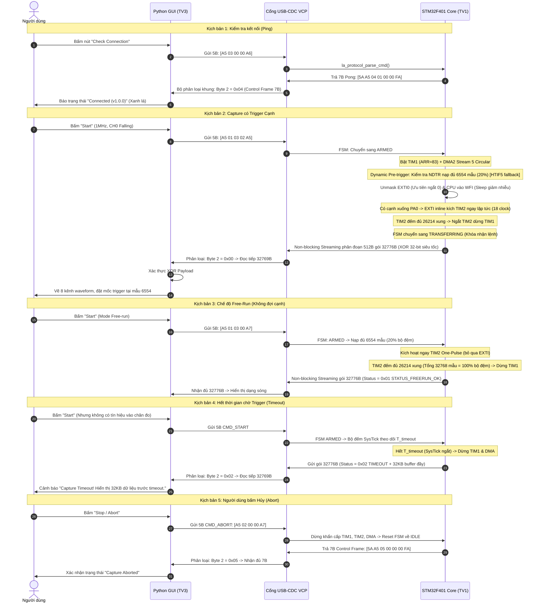

# Hợp đồng Giao thức Truyền thông (Communication Protocol Contract)
**Mã hiệu:** PROTOCOL-LA-2026 (Phiên bản v1.0.0)  
**Áp dụng:** Giao tiếp nhị phân giữa STM32F401 (Firmware - TV1) và Python Desktop GUI (Host PC - TV3) qua USB-CDC (Virtual COM Port).  
**Nguyên tắc cốt lõi:** Single Source of Truth (Nguồn sự thật duy nhất), đồng bộ hóa luồng byte chặt chẽ, phân loại khung dứt khoát và phân định trạng thái rõ ràng.

---

## 1. Khung Lệnh Điều khiển từ PC (Host -> Device: 5 Bytes)

Mọi lệnh gửi từ PC xuống STM32 đều có kích thước cố định đúng **5 Bytes**:

```text
+-----------+----------+----------+----------+----------+
|  Byte 0   |  Byte 1  |  Byte 2  |  Byte 3  |  Byte 4  |
+-----------+----------+----------+----------+----------+
|   0xA5    |  CMD_ID  | RATE_IDX | TRIG_CFG | CHECKSUM |
+-----------+----------+----------+----------+----------+
```

### 1.1. Chi tiết các trường dữ liệu
1. **Byte 0 (Magic Header):** Cố định giá trị `0xA5`. Dùng để định vị đầu khung lệnh.
2. **Byte 1 (CMD_ID):**
   * `0x01`: **CMD_START** - Bắt đầu quá trình thu thập tín hiệu logic.
   * `0x02`: **CMD_ABORT** - Hủy bỏ tức thì quá trình capture đang chạy, đưa FSM về `IDLE`.
   * `0x03`: **CMD_PING** - Kiểm tra kết nối và độ sẵn sàng của thiết bị.
3. **Byte 2 (RATE_IDX):** Chọn tần số lấy mẫu (Chỉ có hiệu lực khi `CMD_ID = 0x01`):
   * `0`: 6 MHz (ARR = 13)
   * `1`: 3 MHz (ARR = 27)
   * `2`: 2 MHz (ARR = 41)
   * `3`: 1 MHz (ARR = 83)
   * `4`: 500 kHz (ARR = 167)
   * `5`: 200 kHz (ARR = 419)
   * `6`: 100 kHz (ARR = 839)
   * `7`: 50 kHz (ARR = 1679)
   * `8`: 10 kHz (ARR = 8399)
   *(Nếu RATE_IDX > 8, lệnh bị từ chối bằng khung NAK `ERR_INVALID_RATE`).*
4. **Byte 3 (TRIG_CFG):** Cấu hình kích hoạt Trigger:
   * **4 bit cao `[7:4]` (Trigger Channel):** Kênh số `0` đến `7` (tương ứng chân PA0..PA7).
   * **4 bit thấp `[3:0]` (Trigger Mode):**
     * `0x0`: **Free-run Mode** (Bỏ qua trigger cạnh, thu thập đầy bộ đệm rồi dừng).
     * `0x1`: **Rising Edge** (Kích hoạt khi có cạnh lên trên kênh chỉ định).
     * `0x2`: **Falling Edge** (Kích hoạt khi có cạnh xuống trên kênh chỉ định).
5. **Byte 4 (CHECKSUM):** Byte kiểm tra tính toàn vẹn của lệnh:
   $$\text{CHECKSUM} = \text{Byte 0} \oplus \text{Byte 1} \oplus \text{Byte 2} \oplus \text{Byte 3}$$

### 1.2. Máy trạng thái nhận lệnh phía Firmware (Command Stream Assembler)
Do `CDC_Receive_FS()` có thể nhận dữ liệu phân mảnh thành từng byte:
* Firmware duy trì ring-buffer tích lũy dữ liệu.
* **Thuật toán quét trượt (Sliding Window):** Firmware tìm kiếm byte `0xA5`. Khi tìm thấy và bộ đệm có đủ 5 bytes, tính XOR Checksum.
* **Xử lý sai Checksum:** Nếu Checksum sai hoặc thông số ngoài dải, firmware gửi phản hồi NAK tương ứng, sau đó **chỉ loại bỏ đúng 1 byte `0xA5` đầu tiên** rồi tiếp tục quét tiếp (không xả sạch bộ đệm để không làm mất lệnh hợp lệ nối ngay phía sau).

> [!NOTE]
> **Lưu ý về hiện tượng NAK giả (Spurious NAK):** Do thuật toán quét trượt chỉ loại bỏ 1 byte `0xA5` khi gặp lỗi, nếu trong các byte tham số của một lệnh sai ngẫu nhiên có chứa giá trị `0xA5`, firmware có thể bắt nhầm đó là mốc bắt đầu mới và phát sinh thêm một khung NAK tiếp theo. Đây là hiện tượng chấp nhận được trong mô hình truyền byte stream không đồng bộ; phía GUI (TV3) chỉ cần đối chiếu mã lỗi với lệnh vừa gửi gần nhất và không coi mọi NAK nhận được sau đó là phản hồi cho lệnh mới.

---

## 2. Các Khung Dữ liệu Phản hồi từ STM32 (Device -> Host)

MCU phản hồi về PC bằng một trong hai loại khung cố định kích thước, phân biệt rõ ràng qua **Byte 2 (Status / RSP_CODE)**:

| Loại Khung | Kích thước | Giá trị Byte 2 (Status / RSP_CODE) | Mục đích |
| :--- | :--- | :--- | :--- |
| **Data Frame** | **32.776 Bytes** | `0x00`, `0x01`, `0x02` | Trả về 32KB dữ liệu mẫu sau chu trình Capture |
| **Control Frame** | **7 Bytes** | `0x04`, `0x05`, `0xE0` – `0xE3` | Phản hồi Ping, Abort hoặc báo lỗi NAK |

*(Lưu ý: Miền giá trị của Byte 2 hoàn toàn tách biệt: `0x00 – 0x02` dành riêng cho Data Frame; `0x04 – 0xFF` dành riêng cho Control Frame).*

---

### 2.1. Khung Phản hồi Dữ liệu Mẫu (Data Frame: 32.776 Bytes cố định)

```text
+-----------------------+-----------------------------+--------------------+
|  Header (7 Bytes)     |    Payload (32.768 Bytes)   |  Footer (1 Byte)   |
+-----------------------+-----------------------------+--------------------+
```

* **Header (7 Bytes):**
  * `Byte 0 – 1`: `0x5A, 0xA5` (Chuỗi byte đồng bộ cố định: Byte 0 = `0x5A`, Byte 1 = `0xA5`).
  * `Byte 2`: **Status Byte**
    * `0x00`: **STATUS_TRIGGER_OK** (Bắt được cạnh trigger và ghi đủ 80% post-trigger).
    * `0x01`: **STATUS_FREERUN_OK** (Chế độ Free-run nạp đầy 100% dung lượng bộ đệm).
    * `0x02`: **STATUS_TIMEOUT** (Hết thời gian $T_{\text{mcu-timeout}}$ mà không có trigger, firmware tự dừng).
  * `Byte 3 – 4`: **`trig_offset`** = `6554` (uint16_t Little-Endian: `0x9A, 0x19`).
    *(Vị trí index của điểm trigger trong mảng 32KB; với Free-run mang tính tham khảo).*
  * `Byte 5 – 6`: **`sample_count`** = `32768` (uint16_t Little-Endian: `0x00, 0x80`).
* **Payload (32.768 Bytes):** 
  * Mảng dữ liệu mẫu được sắp xếp liên tục theo trục thời gian từ mẫu cũ nhất ($t_0$) đến mẫu mới nhất ($t_{32767}$).
  * **Cơ chế xoay vòng bộ đệm (Buffer Unrolling) của Firmware:** Do `DMA2_Stream5` hoạt động ở chế độ Circular ghi vòng liên tục vào `la_capture_buffer[32768]`, khi quá trình lấy mẫu dừng lại (do ngắt TIM2 đếm đủ 26.214 mẫu post-trigger hoặc do Timeout), vị trí con trỏ ghi DMA hiện tại (xác định qua `write_pos = 32768 - DMA2_Stream5->NDTR`) chính là vị trí của **mẫu cũ nhất ($t_0$)**, còn mẫu ngay liền trước nó là **mẫu mới nhất ($t_{32767}$)**.
  * Trước khi đẩy qua USB, Firmware có trách nhiệm xoay vòng (unroll) dữ liệu sao cho mẫu tại `write_pos` luôn được đưa về đầu khung payload (index `0`). Nhờ đó, điểm trigger luôn nằm cố định tại vị trí mẫu thứ `trig_offset = 6554` ($t_{6554}$).
  * *Quy tắc khi Timeout:* **Vẫn gửi trọn vẹn 32.768 Bytes** và thực hiện xoay vòng từ `write_pos` tương tự như trên. Lý do: Với công thức timeout $T_{\text{mcu-timeout}} = \frac{16384}{f_s} + 2.0\text{ s}$, thời gian này luôn lớn hơn thời gian nạp đầy toàn bộ bộ đệm $\frac{32768}{f_s}$ đối với mọi tần số $f_s \ge 8.2\text{ kHz}$ ($8.2\text{ kHz} \le 10\text{ kHz}$ - mức thấp nhất). Khi timeout xảy ra, **bộ đệm 32KB luôn đầy 100% dữ liệu hợp lệ và liên tục**, giúp người dùng phân tích được tín hiệu trước thời điểm timeout.
* **Footer (1 Byte):** 
  * Byte kiểm tra XOR tính toán trên toàn bộ 32.768 bytes của phần Payload:
    $$\text{Footer} = \bigoplus_{i=0}^{32767} \text{Payload}[i]$$
  * **Tối ưu hóa tính toán phía MCU (32-bit Unrolled XOR):** Để triệt tiêu độ trễ CPU khi chuẩn bị gửi gói tin, firmware triển khai thuật toán tính XOR song song bằng cách ép kiểu sang từ 32-bit (`uint32_t*`), loop unrolling 8x (xử lý 32 bytes/vòng lặp với 4 biến tích lũy `x0..x3`) và gộp 4 bytes lại bằng 2 phép dịch bit/XOR, đưa thời gian tính toán toàn bộ 32.768 bytes xuống dưới $0.12\text{ ms}$ (tăng tốc gấp ~10 lần so với vòng lặp tuần tự byte).

> [!NOTE]
> **Giới hạn bảo vệ của Footer Checksum:** Byte Footer chỉ tính XOR cho $32.768\text{ Bytes}$ Payload (không bao gồm 7 bytes Header) nhằm tối ưu tốc độ xử lý trong firmware. Tính toàn vẹn của Header được bảo vệ gián tiếp thông qua chuỗi byte đồng bộ `0x5A, 0xA5` và trường hằng số kích thước `sample_count = 32768` (`0x00, 0x80`). Đây là hạn chế kỹ thuật chấp nhận được của phiên bản v1.0.0.

---

### 2.2. Khung Phản hồi Điều khiển / Báo lỗi (Control Frame: 7 Bytes cố định)

```text
+-----------+-----------+----------+----------+----------+----------+----------+
|  Byte 0   |  Byte 1   |  Byte 2  |  Byte 3  |  Byte 4  |  Byte 5  |  Byte 6  |
+-----------+-----------+----------+----------+----------+----------+----------+
|   0x5A    |   0xA5    | RSP_CODE | ECHO_CMD | ECHO_DAT1| ECHO_DAT2| CHECKSUM |
+-----------+-----------+----------+----------+----------+----------+----------+
```

* `Byte 0 – 1`: `0x5A, 0xA5` (Sync Magic).
* `Byte 2 (RSP_CODE)`:
  * `0x04`: **RSP_PONG** - Phản hồi lệnh Ping thành công (Bytes 3–5 là Version Firmware: `0x01, 0x00, 0x00` $\implies$ v1.0.0).
  * `0x05`: **RSP_ABORTED** - Phản hồi xác nhận lệnh Abort thành công (Bytes 3–5 là `0x00, 0x00, 0x00`). Áp dụng cả khi đang capture dở hoặc khi MCU đang ở `IDLE`.
  * `0xE0`: **ERR_CHECKSUM** - Sai checksum của lệnh 5B.
  * `0xE1`: **ERR_INVALID_RATE** - RATE_IDX vượt quá 8.
  * `0xE2`: **ERR_INVALID_TRIG** - Kênh trigger $> 7$ hoặc mode trigger không hợp lệ.
  * `0xE3`: **ERR_BUSY** - MCU đang trong chu trình Capture, từ chối lệnh Start mới (yêu cầu gửi Abort trước).
* `Byte 3 – 5 (Echo Fields)`: Đối với các mã lỗi `0xE0 – 0xE3`, lặp lại nguyên văn 3 byte thông số của lệnh bị lỗi: `Byte 3 = CMD_ID`, `Byte 4 = RATE_IDX`, `Byte 5 = TRIG_CFG` để PC chẩn đoán.
* `Byte 6 (CHECKSUM)`: XOR Checksum của 6 bytes trước đó:
  $$\text{Byte 6} = \bigoplus_{i=0}^{5} \text{Byte}[i]$$

---

## 3. Sơ đồ Trình tự Hoạt động Toàn diện (Mermaid Sequence Diagram)



---

## 4. Xử lý Ngoại lệ, Đồng bộ & Quy tắc Khóa Lệnh (Robustness & Edge Cases)

### 4.1. Quy tắc Phân loại Khung phía GUI (Host Frame Dispatcher)
Để không bị treo khi nhận các khung 7B (PONG, ABORT, NAK), GUI triển khai bộ đọc theo thuật toán:
1. Đọc luồng byte từ cổng serial, tìm kiếm cặp đồng bộ `0x5A, 0xA5`.
2. Đọc tiếp 5 bytes để gom đủ **7 bytes đầu tiên**.
3. **Kiểm tra Byte 2 (Status / RSP_CODE):**
   * Nếu Byte 2 $\in \{0x00, 0x01, 0x02\}$ **VÀ** Byte 5–6 khớp `0x00, 0x80` ($32768$): Xác định là **Data Frame**. GUI đọc tiếp chính xác $32776 - 7 = \mathbf{32769\text{ Bytes}}$ (32.768B Payload + 1B Footer XOR) rồi tiến hành kiểm tra checksum toàn gói.
   * Nếu Byte 2 $\in \{0x04, 0x05, 0xE0, 0xE1, 0xE2, 0xE3\}$: Xác định là **Control Frame (7 Bytes)**. GUI kiểm tra XOR của 7 bytes này và kết thúc lượt đọc ngay lập tức.
   * Nếu Byte 2 không thuộc hai tập trên: Dữ liệu bị nhiễu/lệch, dịch con trỏ qua vị trí `0x5A, 0xA5` hiện tại 1 byte và tiếp tục quét trượt.

### 4.2. Khóa Lệnh khi đang Truyền Dữ liệu & Quản lý Trạng thái FSM (State Locking)
* **Chuẩn hóa các trạng thái FSM lõi của Firmware:**
  * `IDLE`: Chờ lệnh, sẵn sàng nhận `CMD_START`, `CMD_PING`, `CMD_ABORT`. Kênh phát xung kiểm tra Testgen (PA9) chỉ được phép phát định kỳ trong trạng thái này.
  * `ARMED` & `PRE_SAMPLING`: Đã bật TIM1 + DMA2, kênh Testgen PA9 bị ngắt hoàn toàn để tránh tranh chấp bus; kiểm tra động con trỏ ghi DMA `(32768 - NDTR) >= 6554` (nạp đủ $\ge 20\%$ pre-trigger; kèm cờ DMA `HTIF5` làm fallback) để unmask ngắt EXTI sớm nhất có thể.
  * `WAIT_TRIGGER`: Đã kích hoạt ngắt EXTI trên chân chỉ định với quy trình State-Before-Unmask và Memory Barrier `__DSB()`. CPU thực thi `__WFI()` (Wait For Interrupt) đưa Cortex-M4 về Sleep mode để triệt tiêu nhiễu chuyển mạch bus AHB/APB vào kênh đo và tiết kiệm điện năng; sẵn sàng thức dậy tức thì khi có cạnh xung hoặc timeout SysTick.
  * `POST_SAMPLING`: Đã phát hiện cạnh trigger (ISR inline kích hoạt TIM2 tiệm cận phần cứng trong 18 clock cycles), TIM2 One-Pulse đang đếm nốt $26.214\text{ mẫu}$ post-trigger. Khi đếm đủ, lệnh dừng timer được theo sau bởi chỉ thị `__DSB()` để chốt con trỏ `NDTR` chuẩn xác.
  * `TRANSFERRING`: Đang đẩy $32.776\text{ Bytes}$ dữ liệu qua cổng USB-CDC bằng máy trạng thái Non-blocking Streaming phân đoạn 512B. Firmware nhượng quyền CPU cho luồng chính giữa các khối để tiếp tục chạy các tác vụ nền, đồng thời drop toàn bộ byte nhận được từ USB như quy định.
* **Quy tắc phân xử lệnh nhận từ PC:**
  * **Khi FSM ở `TRANSFERRING`:**
    * **Phía MCU:** Bỏ qua hoàn toàn (drop) mọi byte nhận được từ cổng USB. Tuyệt đối không phát sinh khung NAK hay PONG chen ngang làm hỏng luồng dữ liệu 32KB.
    * **Phía GUI:** Bị khóa các nút bấm trên giao diện, cấm gửi bất kỳ lệnh nào (kể cả Ping hay Start) cho đến khi hoàn tất việc nhận trọn vẹn $32.776\text{ Bytes}$ hoặc sau khi quá hạn $T_{\text{gui-timeout}}$.
  * **Khi FSM ở `ARMED`, `PRE_SAMPLING`, `WAIT_TRIGGER`, `POST_SAMPLING`:**
    * Nếu nhận lệnh `CMD_START`: MCU từ chối và phản hồi ngay khung Control 7B với mã lỗi `ERR_BUSY` (`0xE3`).
    * Nếu nhận lệnh `CMD_PING`: Phản hồi `RSP_PONG` (`0x04`).
    * Nếu nhận lệnh `CMD_ABORT`: Dừng khẩn cấp Timer/DMA, reset FSM về `IDLE` và phản hồi `RSP_ABORTED` (`0x05`).

### 4.3. Quy tắc Thời gian Chờ (Timeout Budget)
* **Phía MCU ($T_{\text{mcu-timeout}}$):**
  $$T_{\text{mcu-timeout}} = \frac{16384}{f_s} + T_{\text{wait}}$$
  * Trong phiên bản v1.0.0, **$T_{\text{wait}} = 2.0\text{ s}$ cố định**.
  * Định thời thực hiện bằng biến đếm mili-giây trong trình phục vụ ngắt `SysTick_Handler()`. Hết thời gian này mà chưa xuất hiện cạnh trigger, MCU tự động dừng lấy mẫu và gửi data frame với Status `0x02` (`STATUS_TIMEOUT`).
* **Phía GUI Serial ($T_{\text{gui-timeout}}$):**
  Nếu cạnh trigger xuất hiện sát nút ở cuối cửa sổ chờ $2.0\text{ s}$, MCU vẫn phải tiếp tục lấy thêm $26.214\text{ mẫu}$ post-trigger trước khi truyền dữ liệu. Do đó, thời gian chờ tối đa phía GUI bắt buộc phải tính cả thời gian lấy mẫu post-trigger cộng thêm biên an toàn trễ USB ($1.5\text{ s}$):
  $$T_{\text{gui-timeout}} = \frac{16384 + 26214}{f_s} + T_{\text{wait}} + 1.5\text{ s} = \frac{42598}{f_s} + 3.5\text{ s}$$
  *Ví dụ tại tần số thấp nhất $10\text{ kHz}$:*
  $$T_{\text{gui-timeout}} = \frac{42598}{10000} + 3.5 = 4.26\text{ s} + 3.5\text{ s} \approx 7.76\text{ s}$$
  *(Công thức này đảm bảo GUI không bao giờ ngắt kết nối hoặc báo lỗi timeout oan trước khi MCU hoàn tất chu trình capture).*

### 4.4. Máy Trạng Thái Non-blocking Streaming & Cấu Hình TxFIFO USB (`TxState` Watchdog)
* **Tối ưu hóa TxFIFO USB Phần cứng (RM0368 Section 22.12.2):**
  * Tận dụng tối đa 320 words Dedicated Packet RAM: Phân bổ Rx = 64 words (256B), Tx0 = 32 words (128B), và Tx1 = **224 words (896 Bytes)** cho EP1 Bulk IN. Dung lượng 896B đệm trước được 14 packets 64B, triệt tiêu nguy cơ trễ khung (FIFO Starvation).
* **Máy trạng thái Non-blocking USB Streaming:**
  * Firmware chia nhỏ dữ liệu thành các khối 512B và truyền theo cơ chế máy trạng thái phi phong tỏa. Mỗi vòng lặp của luồng chính, nếu `hcdc->TxState != 0` (phần cứng USB đang bận gửi block trước), firmware nhượng quyền CPU ngay lập tức cho các tác vụ nền khác thay vì dùng vòng lặp chờ bận (busy-wait polling) giam giữ 100% CPU.
* **Cơ chế Watchdog bảo vệ:**
  * Khi gọi `CDC_Transmit_FS()` cho từng khối block 512B:
    * Firmware theo dõi mốc thời gian hoạt động với biến watchdog $100\text{ ms}$ cho mỗi block.
    * Nếu quá $100\text{ ms}$ mà cờ `hcdc->TxState` không trở về `0` (do người dùng rút cáp USB hoặc phần mềm GUI đóng cổng COM đột ngột): Firmware lập tức hủy chu trình truyền, cưỡng bức reset `hcdc->TxState = 0`, giải phóng bộ đệm và đưa FSM về `IDLE`.

---

## 5. Dữ liệu Mẫu & Vector Kiểm thử (Test Vectors cho TV3)

### 5.1. Bảng Khung Lệnh Mẫu Chuẩn (Host -> Device)
* **Start 1 MHz, Trigger Kênh 0 Falling (Chuẩn kịch bản test):**
  `A5 01 03 02 A5`  
  *(Kiểm tra: $0xA5 \oplus 0x01 \oplus 0x03 \oplus 0x02 = 0xA5$)*.
* **Start 6 MHz, Trigger Kênh 0 Rising:**
  `A5 01 00 01 A5`  
  *(Kiểm tra: $0xA5 \oplus 0x01 \oplus 0x00 \oplus 0x01 = 0xA5$)*.
* **Start 1 MHz, Free-run:**
  `A5 01 03 00 A7`  
  *(Kiểm tra: $0xA5 \oplus 0x01 \oplus 0x03 \oplus 0x00 = 0xA7$)*.
* **Ping:**
  `A5 03 00 00 A6`
* **Abort:**
  `A5 02 00 00 A7`

### 5.2. Bảng Khung Phản hồi Mẫu Chuẩn (Device -> Host)
* **PONG (v1.0.0):**
  `5A A5 04 01 00 00 FA`  
  *(Kiểm tra: $0x5A \oplus 0xA5 \oplus 0x04 \oplus 0x01 \oplus 0x00 \oplus 0x00 = 0xFA$)*.
* **ABORT ACK:**
  `5A A5 05 00 00 00 FA`  
  *(Kiểm tra: $0x5A \oplus 0xA5 \oplus 0x05 \oplus 0x00 \oplus 0x00 \oplus 0x00 = 0xFA$)*.
* **NAK Sai Checksum (Lệnh gửi A5 01 00 01 00):**
  `5A A5 E0 01 00 01 1F`  
  *(Echo lại CMD=01, RATE=00, TRIG=01; Checksum = $0x5A \oplus 0xA5 \oplus 0xE0 \oplus 0x01 \oplus 0x00 \oplus 0x01 = 0x1F$)*.

### 5.3. Cấu trúc Tệp Dữ liệu Giả lập `software/tests/sample_data_1mhz.bin`
Tệp nhị phân giả lập đúng **32.776 Bytes** phục vụ TV3 kiểm thử GUI độc lập:
* **Tần số giả lập:** **$1\text{ MHz}$** (ghi rõ trong tên tệp và metadata).
* **7 Bytes Header:** `5A A5 00 9A 19 00 80` (Magic `5A A5`, Status `00` OK, trig_offset `6554`, sample_count `32768`).
* **32.768 Bytes Payload:**
  * **Kênh 1 – 7:** Cố định mức logic 0 (`0x00`).
  * **Kênh 0 (PA0):** Tín hiệu UART TX chuẩn 115.200 bps:
    * Trạng thái nghỉ (Idle) của UART: Mức cao (Bit 0 của các byte = `1`).
    * **Định vị điểm Trigger:** Các mẫu từ index `0` đến `6553` ở mức cao `1` (UART Idle); mẫu index `6554` là mẫu đầu tiên chuyển xuống mức thấp `0` (Falling edge - Start bit của UART) để khớp hoàn hảo với mốc `trig_offset = 6554` của GUI.
    * Nội dung ký tự truyền: Chuỗi `"TEST_LA_2026\r\n"`.
    * Độ rộng mỗi bit UART tại 1 MHz: $\frac{1.000.000}{115.200} \approx 8.68\text{ mẫu}$.
* **1 Byte Footer:** Byte XOR của toàn bộ 32KB payload.
